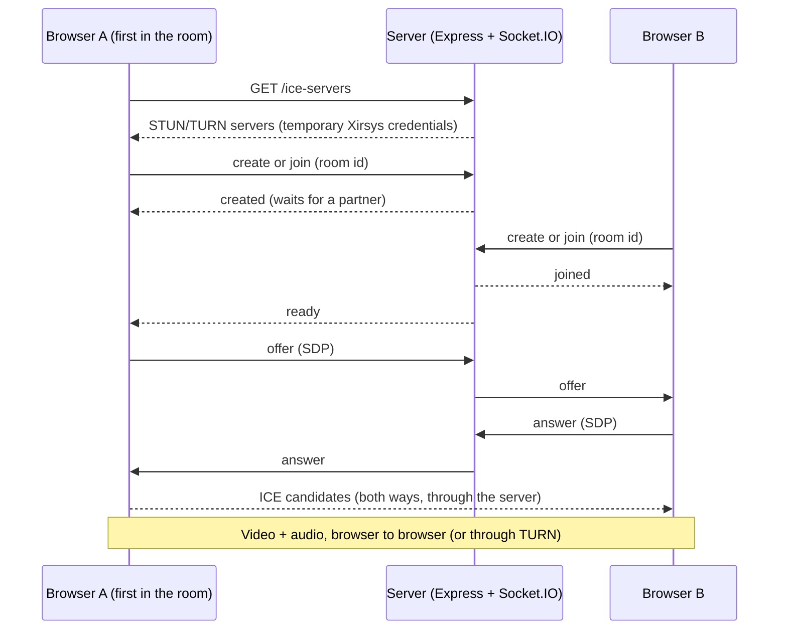

# Study Partner — simple video chat

<p align="center">
  
</p>

A one-to-one video chat for studying with a partner. You sign up, create a room
(or join one by its name), and talk face to face with video, audio and a text
chat. The video goes directly between the two browsers with **WebRTC**. The
server only introduces the two browsers to each other (the *signaling*) with
**Socket.IO**.

| Version | Folder | What it is |
|---|---|---|
| **v1** | [`v1/`](v1) | The original 2021 project, with its bugs and security problems fixed. Same architecture. |

## Features

- Sign up and log in (Passport, passwords hashed with bcrypt, MongoDB).
- Create a room with a unique name, or join an existing one by name.
- Peer-to-peer video and audio with WebRTC (two people per room).
- Text chat inside the room, with emojis.
- STUN/TURN servers from [Xirsys](https://xirsys.com/), with temporary credentials made by the server.

## How it works



1. **Login session.** Express keeps the session in a cookie. Socket.IO reuses
   that session, so only logged-in users can connect to the signaling server.
2. **Room.** The server lets two sockets into a room. The first gets
   `created`, the second gets `joined`, and the first one then gets `ready`.
   A third person gets `full`.
3. **Offer and answer.** The browser that was waiting creates an *offer*. It
   describes its video, audio and codecs. The other browser answers.
4. **ICE.** Each browser finds ways to be reached (local IP, public IP from
   STUN, or a relay address from TURN). They send these *candidates* through
   the server until one pair works.
5. **Hang up.** The browser sends `bye` when you hang up, close or reload the
   tab. The other person stays in the room, and a new partner can join.
6. **Dropped connection.** If the connection to the server drops (Wi-Fi blip,
   phone in the background), the server keeps the seat for 10 seconds and tells
   the partner. Socket.IO reconnects by itself and the browser takes its seat
   back. The video goes browser to browser, so it usually keeps playing; if the
   WebRTC connection broke too, the browser that made the offer restarts ICE to
   find a new network path. Every signaling message carries the id of its call,
   so messages from a replaced connection are ignored. After 10 seconds without
   coming back, the partner gets `bye` and the seat is free again.

### Project structure (v1)

```
v1/
├── bin/www            # Starts the HTTP server after connecting to MongoDB
├── app.js             # Express app: sessions, Passport, routes, errors
├── config.js          # Reads the environment variables (.env)
├── sockets.js         # Socket.IO signaling server (rooms, offer/answer, chat)
├── controllers/       # Logic of every page (signup, rooms, ICE servers...)
├── routes/            # URLs and which ones need a logged-in user
├── models/            # Mongoose models: Users and Rooms
├── views/             # EJS templates
└── public/            # Browser code (javascripts/main.js = WebRTC + chat) and styles
```

## Installation

### Requirements

- [Node.js](https://nodejs.org/) **20.12 or newer** (it includes npm).
- A MongoDB database. The free tier of [MongoDB Atlas](https://www.mongodb.com/atlas) works, or a local MongoDB server.
- Optional but recommended: a free [Xirsys](https://xirsys.com/) account for TURN.
  Without it, calls between some networks (mobile data, offices) may not connect.

### 1. Get the code and install the dependencies

**Windows (PowerShell)**

```powershell
git clone https://github.com/Josafath/simple-video-chat.git
cd simple-video-chat\v1
npm install
copy .env.example .env
```

**macOS / Linux (Terminal)**

```bash
git clone https://github.com/Josafath/simple-video-chat.git
cd simple-video-chat/v1
npm install
cp .env.example .env
```

### 2. Fill in `v1/.env`

Open `.env` with any editor and set:

| Variable | Required | What to put |
|---|---|---|
| `MONGODB_URI` | yes | Atlas: **Connect → Drivers** and copy the string (add the database name, e.g. `/videochat`). Local: `mongodb://127.0.0.1:27017/videochat` |
| `SESSION_SECRET` | yes | A long random string. Generate one with `node -e "console.log(require('crypto').randomBytes(32).toString('hex'))"` |
| `XIRSYS_IDENT`, `XIRSYS_SECRET`, `XIRSYS_CHANNEL` | no | In Xirsys, create a channel and open **API Info**. The server asks Xirsys for temporary TURN credentials on every call, so the secret never reaches the browser. |
| `ICE_SERVERS` | no | Your own STUN/TURN servers as JSON, used when Xirsys is not set. Default: Google's public STUN. |
| `PORT` | no | Default `3000`. |
| `NODE_ENV` | no | `production` when the app runs behind HTTPS. |

`.env` is in `.gitignore`. Never commit it.

### 3. Run it

```bash
npm start
```

Open http://localhost:3000, sign up, and create a room. To test alone, open a
second browser (or a private window), sign up with another user, and join the
room by its name.

> Browsers only allow the camera on `localhost` or on **HTTPS**. To use it
> from another device, deploy the app with HTTPS (Render, Railway, Fly.io...)
> and set `NODE_ENV=production`.

## What v1 fixed

The original code is in the git history (before the `v1/` folder). These are
the problems that v1 fixes:

**Security**

- The MongoDB password and the TURN credentials were written in the code. They now come from environment variables. The old values are still in the git history, so they must be treated as public and replaced.
- The session secret was `"demoapp"`. It now comes from `SESSION_SECRET`. The cookie is now `httpOnly` and `sameSite`, and it is `secure` in production.
- **XSS in the chat.** Messages were inserted as HTML. Now they are inserted as text.
- Any client could crash the server by sending the `ipaddr` event (it used `os` without importing it). The event was removed.
- `app.locals.currentUser` was shared by every request and could show one user's data to another.
- `/home` and `/home/join` didn't need a login, and Socket.IO accepted anyone. Both now require a session.
- A client could send signaling messages to any room. Now the server only relays to the room the socket joined.
- The user object, password hash included, was printed in the logs.
- `ejs` 2.6 had a remote code execution vulnerability. All dependencies were updated, and `npm audit` reports 0 vulnerabilities.

**Bugs**

- The room counter started at 1, so the second person was treated like the first one and the call never started.
- The chat used `io.emit`, so every message went to every room.
- Creating a room never detected duplicate names (a missing `await`). Rooms now have a unique name.
- Sign-up checked duplicates without waiting for the result, and compared the email against the username. It could crash with "headers already sent". Usernames and emails are now unique, and the forms show clear errors.
- Login failures, unknown rooms and taken names failed silently. They now show a message.
- WebRTC used `addStream`/`onaddstream`, which browsers removed. It now uses `addTrack`/`ontrack` and promises. ICE candidates that arrive early are queued.
- The local video wasn't muted, so you heard your own microphone. `trace()` didn't exist, `bye` was sent twice, and hanging up sent you to the login page.
- After a hangup, the person who stayed can receive a new partner in the same room.
- Unused dependencies were removed (`dotenv`, `express-validator`, `cookie-parser`, `debug`, `http-errors`). Node reads `.env` by itself now.

## Known limitations (v1)

- Two people per room. Group calls would need an SFU (a media server) instead of peer-to-peer.
- Sessions live in memory (`MemoryStore`): they are lost when the server restarts, and it doesn't scale to several servers. A server restart therefore ends calls: the browsers can't reconnect without logging in again. Held seats are also kept in memory.
- No CSRF tokens. The `sameSite=lax` cookie blocks the usual cross-site form posts.
- No automated tests in the repo yet.

## Technologies

- **WebRTC**: real-time peer-to-peer audio and video.
- **Socket.IO**: signaling and chat between clients.
- **Node.js + Express**: web server, sessions and pages (EJS).
- **Passport + bcrypt**: login.
- **MongoDB + Mongoose**: users and rooms.
- **Xirsys**: STUN/TURN servers.

## Author's note

This was the hardest project I made. I've never felt so much confusion and
frustration from not knowing something, but in the end everything paid off.
If you have ideas to improve it, feel free to open an issue or send me an email. :)
